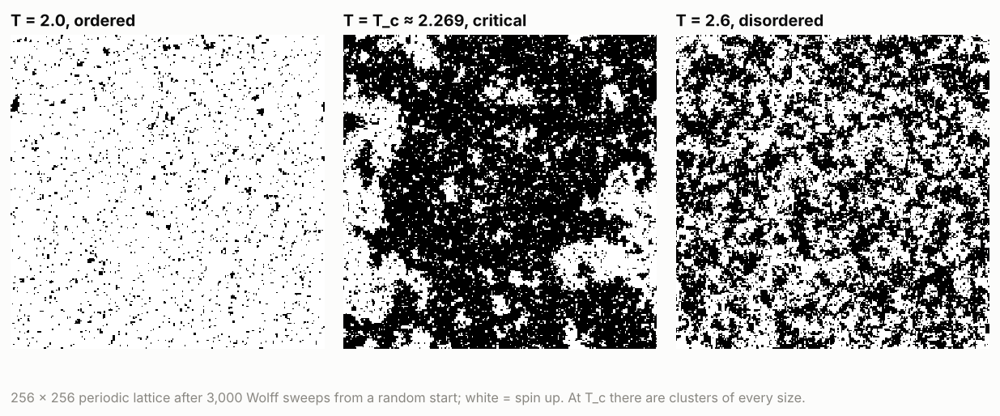
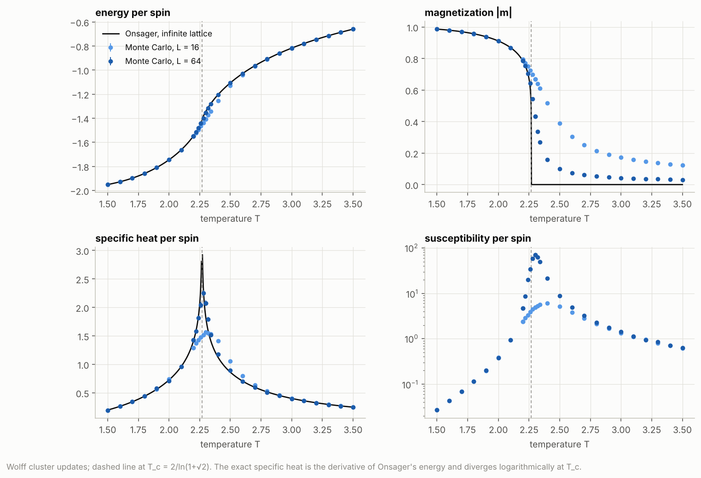
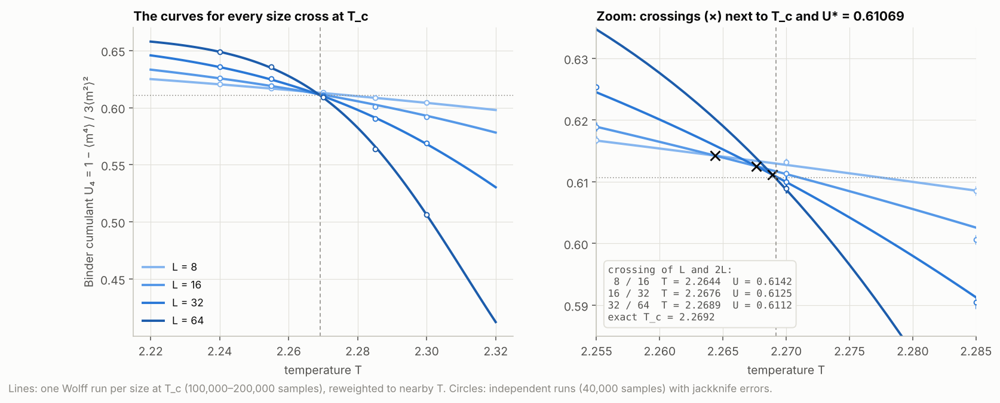
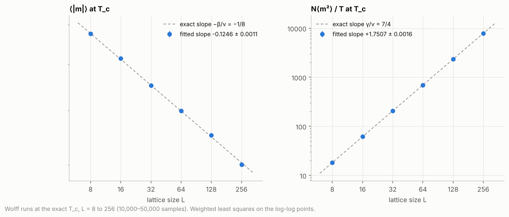
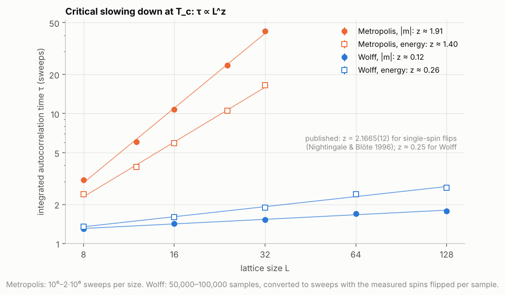

# ising-critical

The two-dimensional Ising model at its phase transition, in C++20 with no
dependencies. It runs local Metropolis and Wolff cluster updates, and every
number it produces is checked against something exact: complete enumeration
of small lattices, Onsager's solution, and the known critical exponents.



## Results

| Claim | Evidence | Grade |
|---|---|---|
| Both Markov chains sample the Boltzmann distribution | On a 4×4 lattice, Monte Carlo averages of energy, \|m\|, specific heat, ⟨m²⟩ and the Binder cumulant match the exact values from all 65,536 states. This holds at three temperatures for both algorithms. The test allows 5σ; the largest deviation in all 30 comparisons is 1.6σ | proven by test, for L = 4 |
| Large lattices reproduce Onsager | At L = 64 the energy agrees with Onsager's exact result within 2σ at every temperature checked away from T_c | measured |
| T_c from Binder-cumulant crossings | Crossings at 2.2644, 2.2676 and 2.2689 for sizes 8/16, 16/32 and 32/64, closing in on the exact 2.2692 | measured |
| Critical exponents | β/ν = 0.1246 ± 0.0011 (exact 1/8) and γ/ν = 1.7507 ± 0.0016 (exact 7/4), from L = 8 to 256 | measured |
| Critical slowing down, and how clusters remove it | Metropolis: τ grows from 3 to 43 sweeps between L = 8 and 32, with local slope 2.12 at the top (published z = 2.1665). Wolff: τ grows only as L^0.26 (published ≈ 0.25) | measured |

## The model

N = L² spins s = ±1 on a square lattice with periodic boundaries, energy
E = −Σ s_i s_j over nearest-neighbour bonds (J = k_B = 1). Onsager solved it
in 1944:

- The transition is at T_c = 2/ln(1 + √2) = 2.26919.
- The energy per spin is known in closed form at every T. It equals −√2 at T_c.
- Below T_c the spontaneous magnetisation is m = (1 − sinh⁻⁴(2/T))^(1/8) (Yang 1952).
- The critical exponents are ν = 1, β = 1/8 and γ = 7/4.

`include/ising/exact.hpp` implements these. It computes the elliptic integral
from the arithmetic–geometric mean, so it needs no special-function library.

## Two algorithms

- **Metropolis** visits each spin in turn and flips it with probability
  min(1, e^(−ΔE/T)). Each move is local, so near T_c, where correlated
  regions span the lattice, it takes ever longer to produce a new
  configuration.
- **Wolff** (1989) grows a cluster from a random spin, adding each aligned
  neighbour with probability 1 − e^(−2/T), then flips the whole cluster. The
  move is always accepted, and its clusters are as large as the physical
  correlations.

### A bug that only the exact test could see

My first Wolff driver took one measurement per "sweep-equivalent": it flipped
clusters until N spins had flipped, then measured. That sounds harmless, but
the stopping time depends on the state. A large cluster, typical of an
ordered state, ends the sweep at once, so ordered states were over-sampled.
On the 4×4 lattice at T = 1.8:

| | energy per spin | \|m\| |
|---|---|---|
| exact enumeration | −1.8587 | 0.9563 |
| measuring once N spins have flipped (biased) | −1.9603 ± 0.0005 | 0.9874 ± 0.0002 |
| measuring every k cluster flips (fixed k) | −1.8595 ± 0.0009 | 0.9567 ± 0.0003 |

The fix: measure after a *fixed* number k of cluster flips, with k calibrated
during equilibration so that one sample still costs about one sweep. The
cost of each sample in sweeps is measured and used to convert
autocorrelation times to sweeps.

## Thermodynamics against Onsager



Away from T_c, the L = 64 data lie on Onsager's curves, within 2σ for the
energy. Near T_c the finite lattices round off the singularities:

- the magnetisation keeps a tail above T_c;
- the specific heat and susceptibility peaks are finite, and grow and
  sharpen with L.

## Locating T_c with the Binder cumulant

U₄ = 1 − ⟨m⁴⟩ / 3⟨m²⟩² tends to 2/3 in the ordered phase and to 0 in the
disordered phase. At T_c it takes the same value for every size, so the
curves cross there. That locates T_c without knowing any exponent (Binder
1981).



The smooth curves come from one long run per size at T_c, reweighted to
nearby temperatures (Ferrenberg & Swendsen 1988). Independent runs at five
temperatures (circles) confirm the reweighting.

The crossings of sizes L and 2L move towards T_c as L grows: 2.2644, 2.2676,
2.2689 against the exact 2.2692. The crossing value approaches 0.61069. That
value was computed by Kamieniarz and Blöte (1993) for square lattices with
periodic boundaries; it is universal only for a fixed shape and boundary
condition (Selke 2006).

## Critical exponents from finite-size scaling

At T_c the only length scale is L, so ⟨|m|⟩ ∝ L^(−β/ν) and
N⟨m²⟩/T ∝ L^(γ/ν).



Weighted straight-line fits from L = 8 to 256 give β/ν = 0.1246 ± 0.0011 and
γ/ν = 1.7507 ± 0.0016. The exact values are 0.125 and 1.75.

## Critical slowing down

The integrated autocorrelation time τ counts the sweeps that one independent
sample costs. At T_c it grows as L^z.



- **Metropolis, |m|:** τ rises from 3 sweeps at L = 8 to 43 at L = 32. A
  straight fit over these sizes gives z = 1.91. The local slope is still
  rising, and reaches 2.12 between L = 24 and 32. This is what corrections
  to scaling at small L would do. The published value is z = 2.1665(12),
  from much larger computations (Nightingale & Blöte 1996).
- **Wolff, energy:** τ grows as L^0.26, close to the published ≈ 0.25.
  Wolff |m| grows even more slowly.
- **The cost:** at L = 32, a Metropolis sample costs about 43 sweeps against
  about 1.5 for Wolff, and the gap widens with every doubling of L.

## Error analysis

Successive Markov-chain samples are correlated, so naive error bars are
too small:

- **Error bars** use the jackknife over 50 contiguous bins. That handles
  non-linear observables like the specific heat and U₄ as well.
- **τ** uses an FFT autocorrelation function with Sokal's automatic window,
  with the Madras–Sokal error estimate.
- **Both are tested** on an AR(1) process, whose τ = (1 + ρ)/(2(1 − ρ)) is
  known exactly.

## Usage

```bash
cmake -S . -B build && cmake --build build -j
ctest --test-dir build                 # 3 test programs, about 4 s
./build/ising-run --L 64 --algo wolff --sweeps 20000
```

```text
wolff, L = 64, T = 2.26919, 20000 samples (1.169 sweeps each)
  energy per spin        -1.425350 +- 0.000846
  |m|                    0.603533 +- 0.002308
  specific heat          2.167171 +- 0.029592
  susceptibility         46.171804 +- 1.154535
  Binder cumulant        0.612513 +- 0.001324
  tau_int(|m|)          1.66 +- 0.07 sweeps
  tau_int(e)            2.33 +- 0.12 sweeps
```

To reproduce every figure (about 4 minutes on two cores), then draw them:

```bash
./build/thermodynamics && ./build/scaling && ./build/snapshots &
./build/binder && ./build/dynamics; wait
pip install numpy matplotlib && python3 scripts/figures.py
```

## Layout

```text
include/ising/
  lattice.hpp     lattice, neighbour tables, energy, magnetisation
  updates.hpp     Metropolis sweep, Wolff cluster step
  simulate.hpp    run a chain, observables with errors, histogram reweighting
  exact.hpp       enumeration of small lattices, Onsager, Onsager-Yang, T_c
  stats.hpp       jackknife, FFT autocorrelation, integrated autocorrelation time
src/ising_run.cpp command-line runner
experiments/      thermodynamics, binder, scaling, dynamics, snapshots (write docs/data/)
tests/            exact results, Monte Carlo against enumeration, error analysis
scripts/          figures.py
```

## Limits

- Square lattice, nearest neighbours, no magnetic field.
- One thread. Independent sizes and temperatures could run in parallel, but
  the code does not do it.
- The dynamic exponents come from modest sizes (Metropolis up to L = 32), so
  they are effective exponents, not precise estimates.

## References

- L. Onsager, *Crystal statistics. I.*, Phys. Rev. 65, 117 (1944).
- C. N. Yang, *The spontaneous magnetization of a two-dimensional Ising model*, Phys. Rev. 85, 808 (1952).
- N. Metropolis, A. W. Rosenbluth, M. N. Rosenbluth, A. H. Teller, E. Teller, J. Chem. Phys. 21, 1087 (1953).
- U. Wolff, *Collective Monte Carlo updating for spin systems*, Phys. Rev. Lett. 62, 361 (1989).
- K. Binder, *Finite size scaling analysis of Ising model block distribution functions*, Z. Phys. B 43, 119 (1981).
- A. M. Ferrenberg, R. H. Swendsen, *New Monte Carlo technique for studying phase transitions*, Phys. Rev. Lett. 61, 2635 (1988).
- G. Kamieniarz, H. W. J. Blöte, *Universal ratio of magnetization moments in two-dimensional Ising models*, J. Phys. A 26, 201 (1993).
- W. Selke, *Critical Binder cumulant of two-dimensional Ising models*, Eur. Phys. J. B 51, 223 (2006).
- M. P. Nightingale, H. W. J. Blöte, *Dynamic exponent of the two-dimensional Ising model*, Phys. Rev. Lett. 76, 4548 (1996).
- M. E. J. Newman, G. T. Barkema, *Monte Carlo Methods in Statistical Physics*, Oxford (1999).
- A. D. Sokal, *Monte Carlo methods in statistical mechanics: foundations and new algorithms*, lecture notes (1996).

## Licence

Copyright (c) 2026 Ankit Pawar. All Rights Reserved.

This repository is public so that the work can be read and evaluated, but it is not open source. Using, copying, modifying, redistributing or commercially exploiting any part of it requires prior written permission. This does not affect what applicable law allows without permission, or viewing and forking the repository on GitHub under GitHub's Terms of Service. The full terms are in [LICENSE](LICENSE).

Commits up to and including `fdf2733` were released under the MIT License, and copies obtained under those terms keep them.

For licensing or collaboration, email ankitpawar0007x@gmail.com or visit [ankitinorbit.com](https://ankitinorbit.com).
